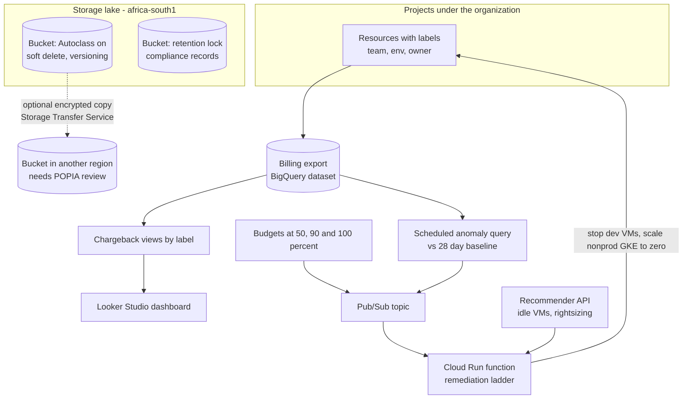
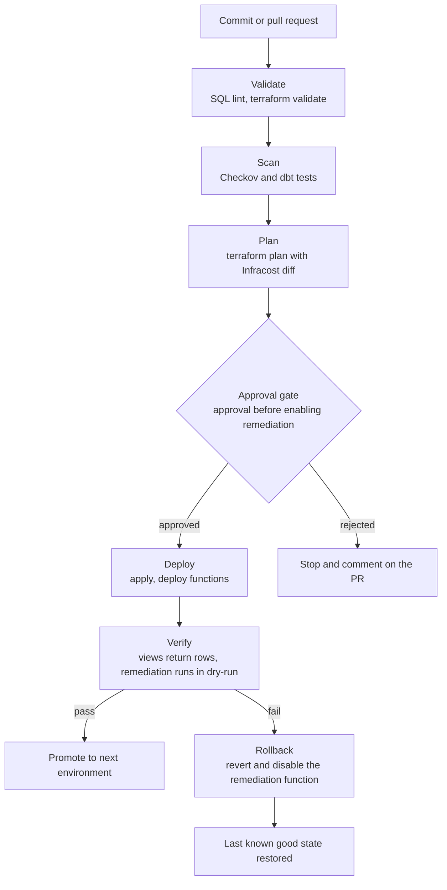
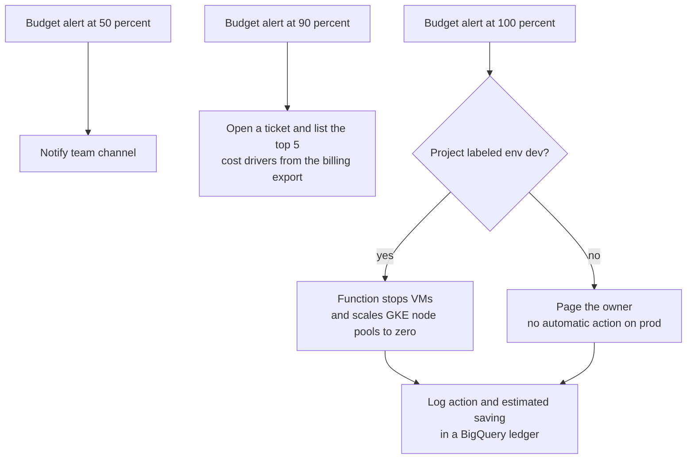

# BigQuery FinOps Lake

A billing-to-BigQuery cost engine plus a governed Cloud Storage lake with Autoclass and retention locks, where Pub/Sub budget alerts trigger cleanup.

### Business use case

A South African agency or SME has many projects and no view of spend by team, while storage quietly grows. The platform shows chargeback by label, locks compliance records, and stops dev spend when a budget is breached.

### The hard piece

Automated cost remediation with storage lifecycle control

### Rough monthly cost, ZAR

R100 to R500 a month. BigQuery and Cloud Storage have free tiers, and the functions are tiny, so this is the cheapest project to leave running.

### Tool stack

- Cloud Billing export to BigQuery
- BigQuery views + scheduled queries
- Looker Studio
- Recommender API
- Budgets + Pub/Sub
- Cloud Run functions + Eventarc
- Cloud Scheduler + Workflows
- Cloud Storage (Autoclass, lifecycle, soft delete, versioning)
- Bucket Lock retention
- CMEK
- Storage Transfer Service
- Cloud Asset Inventory
- Infracost
- Terraform
- GitHub Actions + Workload Identity Federation
- dbt (optional)

### Diagrams

#### Diagram 1 · Architecture: billing data, remediation and the lake

> **How to read this:** Everything starts with labels: without them, the billing export cannot say who spent what. The export feeds dashboards and an anomaly query, and both budgets and anomalies publish to the same Pub/Sub topic, so one function handles every trigger. The lake at the bottom is separate: Autoclass moves data between storage classes on its own, and the locked bucket cannot be shortened or deleted early.

#### Diagram 2 · CI/CD: SQL, functions and cost diff

> **How to read this:** Follow the top line from a commit to a deploy: the pipeline stops at the first red step, and nothing reaches the approval gate unless validation, scanning and the plan all passed. The bottom branch is the one hiring managers ask about: when verification fails, the rollback box puts the environment back without a human editing the console. Infracost adds the unusual part: the PR shows what the change will cost before it merges.

#### Diagram 3 · Hard piece: the budget ladder

> **How to read this:** The ladder escalates with spend: tell, then investigate, then act. Automatic action is limited to projects labeled dev. Prod only pages a human, which is the safeguard you should call out in an interview.

### How it covers the five focus areas

- **Compute** (light): Cloud Run functions and jobs, Scheduler-driven stop and start of dev VMs and nonprod GKE, Spot for batch.
- **Networking** (light): Cloud Run with internal ingress, private bucket access, optional reuse of the VPC Service Controls perimeter from the landing zone.
- **Storage · HOME**: Autoclass versus lifecycle experiment, soft delete, versioning, Bucket Lock, CMEK, BigQuery partition expiry and long-term storage pricing, a documented DR option.
- **CI/CD** (deep): Terraform, SQL and function deploys in one pipeline, Infracost cost diff in PRs, dry-run first.
- **Cost optimisation · HOME**: Billing export, label-based chargeback, budgets, anomaly query, Recommender, BigQuery cost controls (maximum bytes billed), a savings ledger.
### Advanced features that show depth

- Chargeback views by label with an 'unlabeled' bucket that you drive towards zero
- Anomaly query against a 28-day baseline
- A remediation ladder that only acts on dev
- Infracost in every pull request
- BigQuery guardrails: maximum bytes billed and custom quotas, with a before-and-after cost test

### Production-like touches

- Dev and prod datasets and functions
- Alerts on pipeline failures and anomalies
- Runbook: a budget was breached, what to check first
- Post-incident write-up: a function stopped a VM that was labeled wrongly
- Monthly chargeback report

### AWS to GCP bridge

| AWS | Google Cloud | Where it differs |
| --- | --- | --- |
| CUR + Athena | Billing export to BigQuery | The export is native and queryable immediately. You write the anomaly logic yourself. |
| S3 Intelligent-Tiering | Cloud Storage Autoclass | Autoclass moves objects between classes on its own. |
| S3 Object Lock | Bucket Lock / retention policy | Locking a retention policy is permanent. |
| Lambda | Cloud Run functions | Triggered by Pub/Sub or Eventarc. |
| EventBridge Scheduler | Cloud Scheduler | Cron to HTTP or Pub/Sub. |
| Account budget actions | Budgets + Pub/Sub + function | Budgets only notify, so you build the action yourself. |

### Résumé pitch

- Built a billing-to-BigQuery FinOps pipeline with label-based chargeback covering \[N\]% of spend.
- Automated budget-triggered cleanup of dev resources, saving an estimated R\[N\] a month.
- Reduced storage cost by \[N\]% with Autoclass and lifecycle rules while keeping locked retention for compliance records.

> *Replace every \[N\] with a number you measured. If you cannot measure it, remove the claim.*
